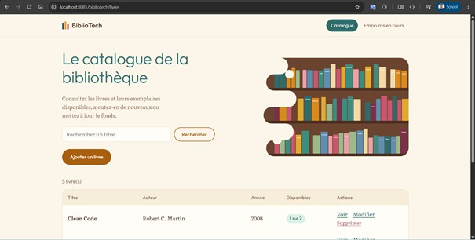
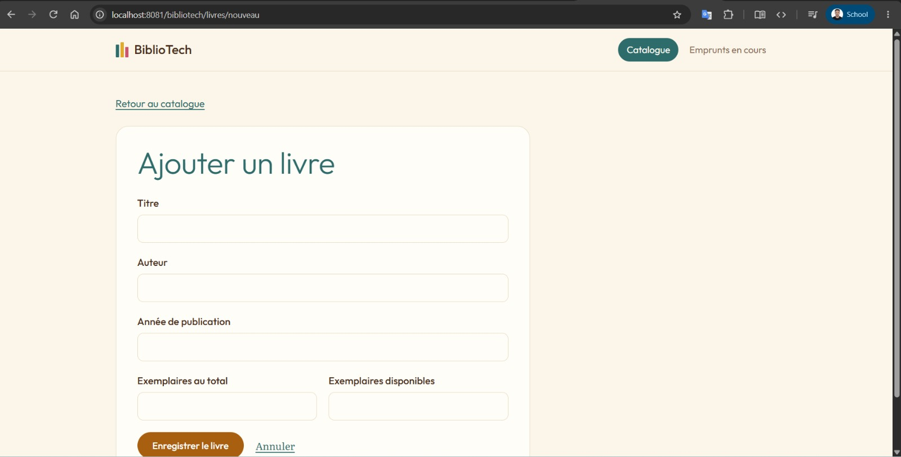
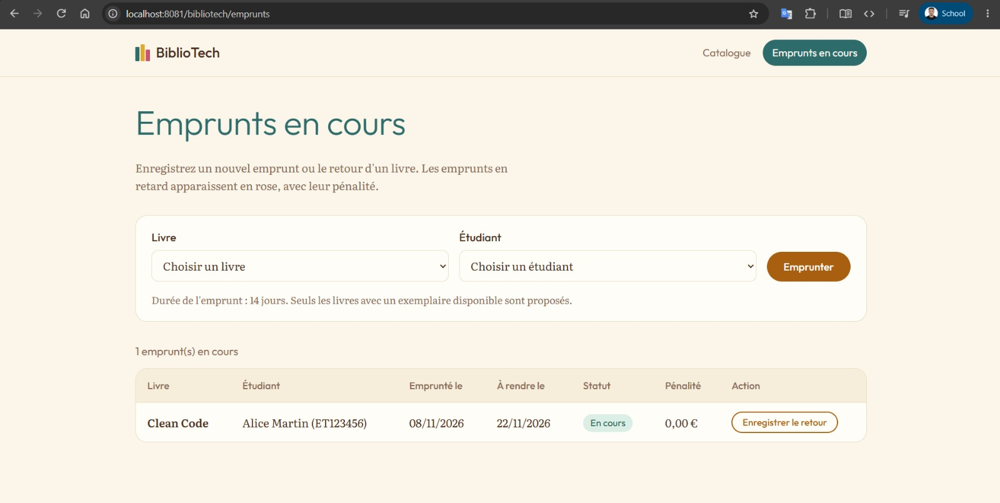

# BiblioTech : TP01 Jakarta EE

Application web de gestion de bibliothèque universitaire : catalogue de livres (CRUD),
emprunts, retours, retards et pénalités.

📄 [Compte rendu du TP (PDF)](docs/Compte_rendu_TP01_BiblioTech_HAJJI.pdf)

## Stack technique

| Brique | Version |
|---|---|
| Java | 21 (Temurin) |
| Jakarta EE | 10 (Servlet 6.0, JSP, JSTL 3.0) |
| Tomcat | 10.1.60 |
| PostgreSQL | 18.6 |
| Maven | 3.9.16 |
| Tests | JUnit 5 |

## Structure du projet

```
bibliotech/
├── pom.xml
├── sql/schema.sql                         # tables + données de démo
├── docs/captures/                         # captures d'écran exigées
└── src/
    ├── main/java/com/bibliotech/
    │   ├── model/   Livre, Etudiant, Emprunt (records), StatutEmprunt (sealed),
    │   │            PenaliteCalculator, ValidationException, LivreIndisponibleException
    │   ├── dao/     GenericDAO, LivreDAO, EmpruntDAO, EtudiantDAO,
    │   │            DatabaseConnection, DAOException
    │   └── web/     HealthServlet, LivreServlet, EmpruntServlet, LigneEmprunt
    ├── main/webapp/WEB-INF/
    │   ├── web.xml
    │   ├── livres/   list.jsp, detail.jsp, form.jsp
    │   └── emprunts/ list.jsp
    └── test/java/com/bibliotech/
        ├── model/   ModelValidationTest, PenaliteCalculatorTest
        └── dao/     EmpruntDAOTest, EnregistrerEmpruntTest, RaceConditionTest
```

Architecture MVC : les **servlets** (contrôleurs) appellent les **DAO** (accès aux données)
et transmettent les **records** (modèle) aux **JSP** (vues, JSTL uniquement, zéro scriptlet).

## Lancer le projet

### 1. Base de données
```sql
-- En tant que postgres :
CREATE ROLE bibliotech_app WITH LOGIN PASSWORD '<mot_de_passe>';
CREATE DATABASE bibliotech OWNER bibliotech_app;
```
Puis, sur la base `bibliotech`, exécuter `sql/schema.sql` précédé de `SET ROLE bibliotech_app;`.

(Alternative Docker proposée par le sujet :
`docker run --name pg-bibliotech -e POSTGRES_PASSWORD=secret -p 5432:5432 -d postgres:16`)

### 2. Variables d'environnement (jamais dans le code)
```
DB_URL=jdbc:postgresql://localhost:5432/bibliotech
DB_USER=bibliotech_app
DB_PASSWORD=<mot_de_passe>
```
À définir pour Tomcat (configuration de lancement) et pour les tests.

### 3. Build et déploiement
```
mvn clean package        # compile, lance les 33 tests, produit target/bibliotech.war
```
Déployer `target/bibliotech.war` sur Tomcat 10.1.

> Tomcat est configuré sur le port **8081** (le port 8080 est occupé par un autre service sur ma machine).

### 4. Accès à l'application

Une fois Tomcat démarré (port **8081**) :

| Page | Adresse | Ce qu'on y fait |
|---|---|---|
| Catalogue | [localhost:8081/bibliotech/livres](http://localhost:8081/bibliotech/livres) | Consulter, rechercher, ajouter, modifier et supprimer des livres |
| Emprunts en cours | [localhost:8081/bibliotech/emprunts](http://localhost:8081/bibliotech/emprunts) | Enregistrer un emprunt ou un retour, voir les retards et les pénalités |
| État du service | [localhost:8081/bibliotech/health](http://localhost:8081/bibliotech/health) | Vérifier que l'application et la base répondent (`OK` + version de PostgreSQL, ou `KO` en erreur 500) |

## Captures d'écran
### Catalogue


### Formulaire d'ajout d'un livre


### Emprunts en cours


## Choix techniques
- **`Rendu` a un champ `joursDeRetard`** : nécessaire pour appliquer la pénalité de 0,50 €/jour.
- **Validation complète** : le record `Livre` collecte toutes les erreurs (`ValidationException`, qui hérite de `IllegalArgumentException`), affichées sous chaque champ.
- **Statut « en retard » calculé** à partir des dates, et non stocké en base.
- **Rôle PostgreSQL dédié** `bibliotech_app` (moindre privilège) et contraintes `CHECK` en base.
- **Sécurité** : `PreparedStatement` partout, `<c:out>` partout, cookie de session `HttpOnly` et transmis uniquement par cookie.

## Choix techniques
- **`Rendu` a un champ `joursDeRetard` en plus** : le record du sujet ne stockait pas le nombre de jours, ce qui empêchait de calculer la pénalité de 0,50 €/jour.
- **Utilisateur PostgreSQL dédié `bibliotech_app`** : l'application n'utilise pas le super-utilisateur `postgres`.
- **Tomcat sur le port 8081** : le port 8080 était déjà pris par un autre service (`httpd.exe`).

## Réponses aux questions

### Q0.1 : Pourquoi `provided` ?
Tomcat contient déjà l'API Servlet. On en a besoin pour compiler, mais pas dans le WAR : `provided` dit justement à Maven de ne pas l'y mettre.
En `compile`, le jar serait copié dans le WAR. Les mêmes classes existeraient alors deux fois (dans Tomcat et dans l'application), ce qui alourdit le WAR et peut créer des conflits.

### Q0.2 : Pourquoi ne pas mettre les identifiants dans le code ?
Git garde tout l'historique : un mot de passe poussé une fois reste visible pour toujours, et n'importe qui peut le lire sur un dépôt public.
Deux autres solutions pour les sortir du code :
- une **DataSource JNDI** déclarée dans le `context.xml` de Tomcat ;
- un **fichier de configuration** (ex. `db.properties`) exclu de Git par le `.gitignore`.

### QA.1 : Pourquoi un Record est-il immuable ?
Ses champs sont `final` et il n'a pas de setters : une fois créé, on ne peut plus le modifier.
Dans Tomcat, une seule instance de Servlet sert plusieurs requêtes en même temps. Un objet qui ne peut pas changer peut être partagé entre ces threads sans risque, sans avoir besoin de synchronisation.

### QA.2 : Sealed interface ou interface classique ?
Une interface classique peut être implémentée par n'importe quelle classe. Une interface `sealed` donne la liste exacte des classes autorisées (`permits`), et le compilateur refuse les autres.
Avantage : dans un `switch`, le compilateur connaît tous les cas possibles. Il vérifie qu'on n'en oublie aucun, et on n'a plus besoin de `default`.

### QA.3 : Exhaustivité du switch et ajout de `Perdu`
Comme l'interface est `sealed`, le compilateur sait qu'un statut ne peut être que `EnCours`, `Rendu` ou `EnRetard`. Si les trois sont traités, le `switch` est complet : pas besoin de `default`.
Si on ajoutait `Perdu`, le `switch` ne serait plus complet et le code ne compilerait plus. Le compilateur nous obligerait à gérer ce nouveau cas, au lieu de laisser passer un bug silencieux.

### QB.1 : Pourquoi un formulaire HTML ne fait que GET et POST ?
La norme HTML n'autorise que `get` et `post` dans l'attribut `method` d'un formulaire. Les formulaires ont été conçus pour deux usages : **lire** une page (GET) et **envoyer** des données (POST).
PUT et DELETE ont été envisagés pour HTML5, puis abandonnés : on ne savait pas bien comment le navigateur devait gérer leurs réponses, et ils auraient permis à n'importe quel site d'envoyer ces requêtes vers un autre site.
On contourne la limite avec un POST vers une URL dédiée (ex. `POST /livres/3/delete`), ou avec `fetch()` en JavaScript.

### QB.2 : `${livre.titre}` ou `<c:out value="${livre.titre}"/>` ?
`${livre.titre}` écrit la valeur **telle quelle** dans le HTML. `<c:out>` **échappe** les caractères spéciaux (`<` devient `&lt;`, `>` devient `&gt;`, `"` devient `&#034;`…).
Exemple avec le titre `<script>alert('XSS')</script>` :
- avec `${livre.titre}`, le navigateur reçoit une vraie balise `<script>` et **exécute** le code (faille XSS) ;
- avec `<c:out>`, il reçoit `&lt;script&gt;…` et **affiche** simplement le texte, sans l'exécuter.

### QB.3 : Que se passe-t-il sans PRG ?
L'utilisateur ajoute un livre : le serveur fait l'INSERT puis un forward vers la liste, et l'URL reste celle du POST.
S'il appuie sur F5 (ou revient en arrière puis en avant), le navigateur propose de renvoyer le formulaire.
S'il accepte, le même POST repart, un second INSERT est fait, et le livre apparaît **en double** dans le catalogue.

### QC.1 : Pourquoi créer `GenericDAO<T, ID>` dès le premier DAO ?
1. **On peut changer l'implémentation sans toucher au reste.** La servlet ne connaît que l'interface : on est passé de `LivreDAOMemoire` (partie B) à `LivreDAO` (JDBC) en modifiant une seule ligne.
2. **Tous les DAO ont la même forme.** `LivreDAO` et `EmpruntDAO` offrent les mêmes méthodes (`findAll`, `findById`, `save`, `update`, `delete`) : le code est plus lisible, et on écrit une seule fois un code qui marche pour tous les DAO.
Bonus : on peut tester une servlet avec un faux DAO en mémoire, sans base de données.

### QC.2 : Pourquoi `PreparedStatement` plutôt que `Statement` ?
1. **Sécurité : il bloque l'injection SQL.** Les valeurs sont envoyées à part, avec des `?`. Elles ne sont jamais lues comme du code SQL.
   Avec `Statement` et une concaténation, un titre comme `' OR '1'='1` ou `'; DROP TABLE livre; --` changerait le sens de la requête.
2. **Performance : la requête est préparée une seule fois.** La base peut réutiliser son plan d'exécution quand on relance la même requête avec d'autres valeurs.
En plus, le driver gère lui-même les types et les caractères spéciaux (dates, apostrophes comme dans « L'Étranger »…).

### QC.3 : Que se passe-t-il sans `setAutoCommit(false)` ?
Sans cette ligne, JDBC valide chaque requête **dès qu'elle est exécutée**.
Si une erreur arrive entre l'UPDATE et l'INSERT : l'UPDATE est déjà enregistré (le livre a **un exemplaire disponible en moins**), mais l'INSERT n'a pas eu lieu (**aucun emprunt** n'est créé).
La base est alors **incohérente** : un exemplaire a « disparu » sans que personne ne l'ait emprunté, et le `rollback()` ne peut rien annuler, puisque tout est déjà validé.

## Bonus 1 : Race condition sur le dernier exemplaire

**Reproduction** : `RaceConditionTest` lance deux threads (`ExecutorService` + `CountDownLatch`) qui empruntent en même temps le dernier exemplaire. Sans correction : **2 emprunts réussis, stock à -1**.

**Diagnostic** : en READ COMMITTED (niveau par défaut de PostgreSQL), le `SELECT` ne pose aucun verrou. Les deux transactions lisent « 1 disponible » avant que l'une d'elles ait validé, et passent toutes les deux la vérification. Le second `UPDATE` attend le premier, puis décrémente à partir de 0 : on obtient -1. La décision est prise sur une lecture devenue périmée (schéma « vérifier puis agir »).

**Correction** : `SELECT … FOR UPDATE`. La ligne du livre est verrouillée jusqu'au commit, le second emprunteur attend puis lit 0, et il reçoit une `LivreIndisponibleException`. Le test passe au vert : 1 emprunt, 1 refus, stock 0.
Je n'ai pas retenu la contrainte `CHECK (exemplaires_disponibles >= 0)` seule : elle ne prévient pas la course, elle la détecte après coup et renvoie une erreur technique. Elle reste utile en complément (défense en profondeur).

## Bonus 2 : XSS dans la recherche

**Exploit** : avec `Résultats pour : ${param.q}`, la recherche `<script>alert('XSS pwned')</script>` est exécutée par le navigateur (XSS réfléchi).
**Correction** : `<c:out value="${param.q}"/>` échappe `<`, `>`, `&`, `'` et `"` : le texte est affiché, pas exécuté.
**Réflexion** : toutes les autres vues (liste, détail, formulaire avec ses attributs `value`, emprunts, messages) utilisaient déjà `<c:out>` ; un titre de livre piégé (XSS stocké) s'affiche donc comme du texte. Les seules expressions EL non échappées contiennent des valeurs fixées par le serveur (classes CSS, id numériques).

# BiblioTech : TP02 modernisation JPA / Hibernate

## Réponses aux questions

### Q1.1 : Pourquoi EntityManagerFactory est un singleton et EntityManager créé par requête ?
L’EntityManagerFactory est lourde à créer : au démarrage, elle lit la configuration, analyse toutes les entités, vérifie le schéma et prépare les connexions. On la crée donc une seule fois pour toute l’application, et elle peut être partagée entre les threads. L’EntityManager, lui, est léger mais pas thread-safe : il garde en mémoire les entités qu’il a chargées (son contexte de persistance). On en crée un par requête, ou par opération, et on le ferme à la fin. Partager un EntityManager entre plusieurs requêtes mélangerait les données des utilisateurs et ferait grossir sa mémoire sans fin.

### Q2.1 : pourquoi un enum Statut à la place de la sealed interface ?
JPA ne sait enregistrer que des entités, ou des valeurs simples (texte, nombre, date, enum). Il ne sait pas faire correspondre une hiérarchie de records à une colonne. Un record n’a pas de constructeur sans argument, ses champs sont final, et JPA a besoin des deux pour recréer l’objet. De plus, EnRetard contient un nombre de jours qui change chaque jour : le stocker n’aurait pas de sens. On stocke donc un simple enum en texte (@Enumerated(EnumType.STRING)). Ensuite, on recalcule la sealed interface du TP 1 à la lecture, avec statutMetier(). On garde ainsi le pattern matching et le calcul des pénalités, sans les mettre en base.

### Q2.2 : pourquoi tous les @ManyToOne en LAZY ?
Par défaut, un @ManyToOne est en EAGER : charger un emprunt charge aussi, tout de suite, son livre et son étudiant. Avec une requête JPQL qui renvoie 100 emprunts, Hibernate lance alors 1 requête pour les emprunts, puis des requêtes en plus pour chaque livre et chaque étudiant. C’est le problème n+1, même quand on n’a besoin que des dates. Et ce chargement ne peut pas être désactivé au cas par cas. En LAZY, Hibernate met à la place un objet « vide » (un proxy), qu’il ne remplit que si on s’en sert. C’est nous qui choisissons, requête par requête, ce qu’on charge, avec JOIN FETCH.

### Q3.1 : pourquoi findAll() n’a pas de transaction, contrairement à save() et deleteById() ?
findAll() ne fait que lire : il ne modifie rien, donc il n’y a rien à valider ni à annuler. JPA autorise les lectures hors transaction. Hibernate exécute alors la requête en mode autocommit, comme un simple SELECT JDBC. save() et deleteById(), eux, modifient la base. Or JPA n’écrit rien en base sans transaction : un persist ou un remove sans transaction n’est jamais envoyé, ou provoque une erreur. La différence est donc correcte pour une lecture simple. Elle a cependant deux limites. D’abord, plusieurs lectures successives ne voient pas forcément un état cohérent de la base. Ensuite, les relations LAZY ne peuvent plus être chargées après la fermeture de l’EntityManager. Quand on a besoin de cohérence entre plusieurs lectures, on les regroupe dans une même transaction, même en lecture seule.

### Q4.1 : pourquoi ne pas appeler livreRepository.save() puis empruntRepository.save() séparément ?
Chaque save() ouvre et valide sa propre transaction. Imaginons ce scénario : le premier save() décrémente le stock et il est validé en base. Puis le second échoue, par exemple parce que l’étudiant n’existe pas, que la base coupe la connexion ou que Tomcat s’arrête. Le stock a alors baissé de 1 alors qu’aucun emprunt n’existe : un exemplaire est « perdu » pour toujours. Il faut que les deux écritures soient dans la même transaction, pour être validées ensemble ou annulées ensemble. Seul le service connaît cette règle, c’est donc lui qui ouvre la transaction.

### Q4.2 : que se passe-t-il si LivreIndisponibleException est levée après le décrément ?
Tx.inTransaction attrape l’exception, fait un rollback(), puis la relance. Rien n’est enregistré : ni la baisse du stock, ni l’emprunt. En JPA, setExemplairesDisponibles(...) ne modifie d’ailleurs que l’objet Java en mémoire. L’UPDATE n’est envoyé qu’au flush ou au commit, et le rollback efface tout. Au TP 1 en JDBC, l’UPDATE partait tout de suite en base, et c’est notre catch qui appelait rollback() à la main. Si on l’oubliait, le stock restait faux. Ici, ce code est écrit une seule fois dans Tx, et aucun service ne peut l’oublier.

### Q4.3 : pourquoi ne pas mettre @Transactional sur une servlet ?
D’abord, sur Tomcat nu l’annotation ne ferait rien du tout : il n’y a ni CDI ni gestionnaire de transactions pour la lire. Ensuite, même sur un serveur complet, ce serait une mauvaise conception :

S (responsabilité unique) : la servlet gérerait le HTTP et en plus la base de données ;
D (inversion des dépendances) : la couche présentation dépendrait d’un détail de la persistance ;
O (ouvert/fermé) : ajouter une API REST ou un traitement de nuit obligerait à recopier la logique transactionnelle.

En plus, la transaction resterait ouverte pendant tout le rendu de la JSP, et garderait des verrous en base trop longtemps.

### Q5.1 : passer de Tomcat + Tx.inTransaction à WildFly + @Transactional, combien de fichiers à modifier ?
Très peu, et tous au même endroit :

- les services du package service : on remplace Tx.inTransaction(em -> ...) par @Transactional et un EntityManager injecté ;
- le package persistence : JpaUtil et Tx disparaissent, et persistence.xml passe en JTA avec une datasource du serveur ;
- éventuellement les repositories, s’ils reçoivent l’EntityManager injecté au lieu de l’ouvrir eux-mêmes.

Les servlets, les JSP et les entités ne changent pas d’une ligne. C’est la preuve que la séparation en couches marche : un changement technique ne touche que la couche qui en est responsable.

## Logs Hibernate : l'emprunt dans une seule transaction

Log obtenu avec `hibernate.show_sql=true` en cliquant sur « Emprunter » :

(coller ici les 4 premières requêtes : select livre for no key update,
select etudiant, insert emprunt, update livre)

- `for no key update` : verrou posé par `LockModeType.PESSIMISTIC_WRITE`.
  Un second emprunt simultané du même livre attend la fin de la transaction
  (correction de la race condition du TP 1, sans SQL écrit à la main).
- L'INSERT part avant l'UPDATE : avec `GenerationType.IDENTITY`, Hibernate doit
  insérer tout de suite pour récupérer l'id généré par PostgreSQL. L'UPDATE du
  stock est envoyé au flush (dirty checking : aucun appel à save()).
- Les deux écritures sont faites dans le même `Tx.inTransaction(...)` de
  `EmpruntService.enregistrerEmprunt` : elles sont validées ensemble au commit,
  ou annulées ensemble en cas d'erreur.

Après la redirection (PRG), la page /emprunts ne lance que 3 requêtes
(emprunts avec JOIN FETCH, livres, étudiants), quel que soit le nombre d'emprunts.